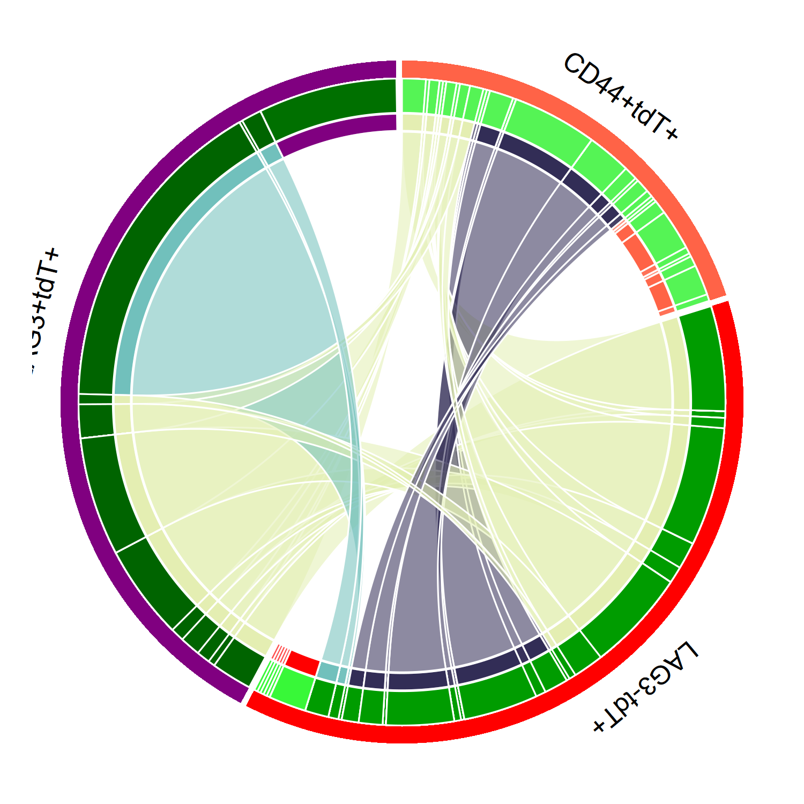

<p align="center">
  
</p>

# Tumour-reactive LAG3<sup>+</sup>CD8<sup>+</sup> T cell fate

Analysis code for:

> **Tumor-reactive LAG3<sup>+</sup>CD8<sup>+</sup> T cells diverge into
> terminally exhausted cells and long-lived memory T cells**
> *Journal of Experimental Medicine* **223**, e20241968 (2026).
> doi:[10.1084/jem.20241968](https://doi.org/10.1084/jem.20241968)

This repository contains the single-cell RNA-seq, TCR-seq, RNA velocity and
ATAC-seq analysis code behind **Figures 3–5**. Mouse line generation, tumour
experiments, adoptive transfer and flow cytometry are described in the paper and
have no code here.

The chord diagram above — clonotype sharing between the tdT<sup>+</sup> subsets,
produced by [`12_fig5_tcr_sharing_chord.R`](2.Script/12_fig5_tcr_sharing_chord.R)
— is a panel from this study.

---

## What the analysis does

A tamoxifen-inducible `Lag3iCreERT2 Rosa26LSL-tdTomato` fate-mapping line labels
cells that have expressed LAG3. Labelled (tdT<sup>+</sup>) CD8<sup>+</sup> T
cells were followed in B16-F10 tumour-bearing mice and profiled by single-cell
RNA-seq with paired TCR-seq, and by ATAC-seq.

- Intratumoural LAG3<sup>+</sup>tdT<sup>+</sup>, LAG3<sup>−</sup>tdT<sup>+</sup>
  and peripheral CD44<sup>+</sup>tdT<sup>+</sup> subsets are clustered and
  compared at day 11 and day 19 (Fig 3).
- RNA velocity and Slingshot trajectories trace how the subsets relate (Fig 3).
- ATAC-seq defines the accessible chromatin landscape of each subset, anchored
  against published naïve / memory / effector / exhausted CD8 references, and
  motif activity is scored with chromVAR (Fig 4).
- Shared TCR clonotypes connect the intratumoural and peripheral subsets,
  showing a common origin and a persisting circulating progenitor pool (Fig 5).

---

## Repository layout

```
1.Data/
  scrna/    single-cell RNA-seq and TCR-seq inputs and derived objects
  atac/     ATAC-seq consensus peaks, counts and derived objects
2.Script/   analysis scripts, numbered in run order
3.Output/   figures and tables produced by the scripts
docs/       repository logo
```

Scripts expect the **repository root** as the R working directory:

```r
setwd("/path/to/lag3-cd8-exhaustion-memory")
source("2.Script/01_scrna_data_init.R")
```

Each R script carries a header giving its figure, inputs, outputs, the upstream
script it depends on, and its original filename in the lab archive. The two
velocity notebooks are Python; their outputs have been cleared so the repository
carries code rather than rendered figures.

---

## Figure → script map

### Single-cell RNA-seq and TCR-seq

| Figure | Analysis | Script |
| --- | --- | --- |
| — | Read CellRanger matrices, build the Seurat object | [`01_scrna_data_init.R`](2.Script/01_scrna_data_init.R) |
| — | QC and batch effect assessment | [`02_scrna_qc_batch_detect.R`](2.Script/02_scrna_qc_batch_detect.R) |
| — | Batch correction (reciprocal PCA, Harmony) | [`03_scrna_batch_correction.R`](2.Script/03_scrna_batch_correction.R) |
| — | Cell cycle scoring | [`04_scrna_cell_cycle_scoring.R`](2.Script/04_scrna_cell_cycle_scoring.R) |
| — | Combine CellRanger `vdj` and TRUST4 TCR calls | [`05_scrna_tcr_prepare.R`](2.Script/05_scrna_tcr_prepare.R) |
| — | Clustering resolution scan | [`06_scrna_clustering_resolution_test.R`](2.Script/06_scrna_clustering_resolution_test.R) |
| — | Final clustering and cluster identities | [`07_scrna_clustering_final.R`](2.Script/07_scrna_clustering_final.R) |
| **3** | Partition and cell distribution at d11 / d19 | [`08_fig3_partition_analysis.R`](2.Script/08_fig3_partition_analysis.R) |
| **3** | Marker gene expression across tdT subsets | [`09_fig3_marker_gene_visualization.R`](2.Script/09_fig3_marker_gene_visualization.R) |
| **3** | Cluster dendrogram and composition bars | [`10_fig3_cluster_dendro_barplot.R`](2.Script/10_fig3_cluster_dendro_barplot.R) |
| **3** | Export embeddings for RNA velocity | [`16_velocity_d11d19_prepare.R`](2.Script/16_velocity_d11d19_prepare.R) |
| **3** | RNA velocity at d11 / d19 | [`17_fig3_velocity_d11d19.ipynb`](2.Script/17_fig3_velocity_d11d19.ipynb) |
| **3** | Slingshot developmental trajectories | [`37_fig3_slingshot_trajectory.R`](2.Script/37_fig3_slingshot_trajectory.R) |
| **5** | TCR repertoire of the tdT subsets | [`11_fig5_tcr_analysis.R`](2.Script/11_fig5_tcr_analysis.R) |
| **5** | Chord diagram of clonotype sharing | [`12_fig5_tcr_sharing_chord.R`](2.Script/12_fig5_tcr_sharing_chord.R) |
| **5** | The same with a *Pdcd1* expression ring | [`13_fig5_tcr_sharing_chord_pdcd1.R`](2.Script/13_fig5_tcr_sharing_chord_pdcd1.R) |
| **5** | Long-term shift of tdT subsets in the periphery | [`14_fig5_long_term_shift.R`](2.Script/14_fig5_long_term_shift.R) |
| — | *Lag3* and *Adam10* expression | [`15_lag3_adam10_expression.R`](2.Script/15_lag3_adam10_expression.R) |
| — | Tumour-set velocity: export, run, plot | [`18`](2.Script/18_velocity_tumor_prepare.R) · [`19`](2.Script/19_velocity_tumor.ipynb) · [`20`](2.Script/20_velocity_tumor_plots.R) |

### ATAC-seq (Figure 4)

| Figure | Analysis | Script |
| --- | --- | --- |
| — | DESeq2 object from consensus peak counts | [`21_atac_deseq_init.R`](2.Script/21_atac_deseq_init.R) |
| — | The same for intratumoural samples | [`22_atac_deseq_init_tumor.R`](2.Script/22_atac_deseq_init_tumor.R) |
| **4** | Differentially accessible peaks for track views | [`23_atac_de_peaks_for_viz.R`](2.Script/23_atac_de_peaks_for_viz.R) |
| **4** | Joint PCA with public reference ATAC datasets | [`24_fig4_joint_pca_with_reference.R`](2.Script/24_fig4_joint_pca_with_reference.R) |
| **4** | Highly variable accessible regions | [`25_atac_highly_variable_peaks.R`](2.Script/25_atac_highly_variable_peaks.R) |
| **4** | Venn comparison of accessible regions | [`26_fig4_common_peaks_venn.R`](2.Script/26_fig4_common_peaks_venn.R) |
| — | Peak accessibility vs gene expression | [`27_atac_peak_gene_correlation.R`](2.Script/27_atac_peak_gene_correlation.R) |
| **4** | Over-representation analysis | [`28_atac_ora.R`](2.Script/28_atac_ora.R) |
| **4** | Functional enrichment of variable peaks | [`29_fig4_variable_peak_enrichment.R`](2.Script/29_fig4_variable_peak_enrichment.R) |
| **4** | Peak-level visualisation | [`30_fig4_peak_visualization.R`](2.Script/30_fig4_peak_visualization.R) |
| **4** | Genome-browser coverage tracks (Gviz) | [`31_fig4_coverage_tracks_gviz.R`](2.Script/31_fig4_coverage_tracks_gviz.R) |
| **4** | Transcription factor motif activity (chromVAR) | [`32_fig4_chromvar_tf_activity.R`](2.Script/32_fig4_chromvar_tf_activity.R) |
| **4** | ggplot rendering of selected regions | [`33_atac_peak_plots.R`](2.Script/33_atac_peak_plots.R) |
| **4** | Opening / closing loci summary | [`34_atac_opening_loci_summary.R`](2.Script/34_atac_opening_loci_summary.R) |
| **4** | Genomic distribution of opening loci | [`35_atac_opening_loci_pie.R`](2.Script/35_atac_opening_loci_pie.R) |
| **4** | Accessibility at the *Tox* locus | [`36_atac_tox_locus_visualization.R`](2.Script/36_atac_tox_locus_visualization.R) |

Run `01` → `07` for the single-cell track and `21` → `25` for the ATAC track
before the figure scripts; those steps write the objects everything else reads.

---

## Data availability

**No sequencing data, bigWig files or intermediate objects are included here.**

| Dataset | Source |
| --- | --- |
| Mouse single-cell RNA-seq and TCR-seq generated for this study | GEO — accession listed in the paper's data availability statement |
| Mouse ATAC-seq generated for this study | GEO — accession listed in the paper's data availability statement |
| Reference ATAC-seq for the joint PCA (public) | GEO [GSE86797](https://www.ncbi.nlm.nih.gov/geo/query/acc.cgi?acc=GSE86797) |
| Naïve / memory / effector / exhausted CD8 epigenetic landscapes from LCMV clone 13 (public) | GEO [GSE149879](https://www.ncbi.nlm.nih.gov/geo/query/acc.cgi?acc=GSE149879) |

### Upstream processing happens before these scripts

The scripts start from **count matrices and consensus peaks**, not FASTQ files:

- **scRNA-seq / TCR-seq** — CellRanger `count` and `vdj`; TRUST4 was run in
  addition to extend repertoire coverage, and the two call sets were merged.
  Spliced / unspliced matrices for RNA velocity came from Velocyto.
- **ATAC-seq** — the nf-core/atacseq pipeline (BWA, MACS2 narrow peaks,
  consensus peaks across merged replicates). The scripts expect
  `consensus_peaks.mRp.clN.featureCounts.txt` and the per-sample bigWig tracks
  under `1.Data/atac/`. The public reference datasets were put through the same
  pipeline into `1.Data/atac/RefGSE86797/`.

---

## Software

| Tool | Notes |
| --- | --- |
| CellRanger (`count`, `vdj`) | mm10 reference |
| TRUST4 | additional TCR assembly |
| Velocyto / scVelo | RNA velocity |
| Seurat, Harmony | clustering and batch correction |
| Slingshot | developmental trajectories |
| nf-core/atacseq (BWA, MACS2) | ATAC-seq alignment and peak calling |
| DESeq2 | differential accessibility |
| sva (`ComBat_seq`) | batch correction preserving integer counts |
| GenomicRanges | consensus peak merging |
| chromVAR, JASPAR2020, BSgenome.Mmusculus.UCSC.mm10 | TF motif activity |
| Gviz, karyoploteR, TxDb.Mmusculus.UCSC.mm10.knownGene | coverage tracks |
| rGREAT | peak annotation and enrichment |
| circlize | chord diagrams |

---

## Contact

**Jian Cui** — Senior Bioinformatics Scientist  
Vignali Lab, Department of Immunology  
School of Medicine, University of Pittsburgh  
<cuij@pitt.edu>

Questions about the analysis or this code are welcome.

## License

[MIT](LICENSE)
